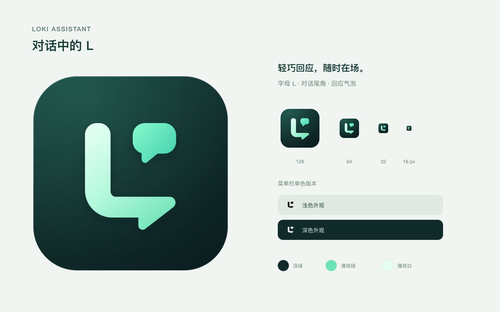
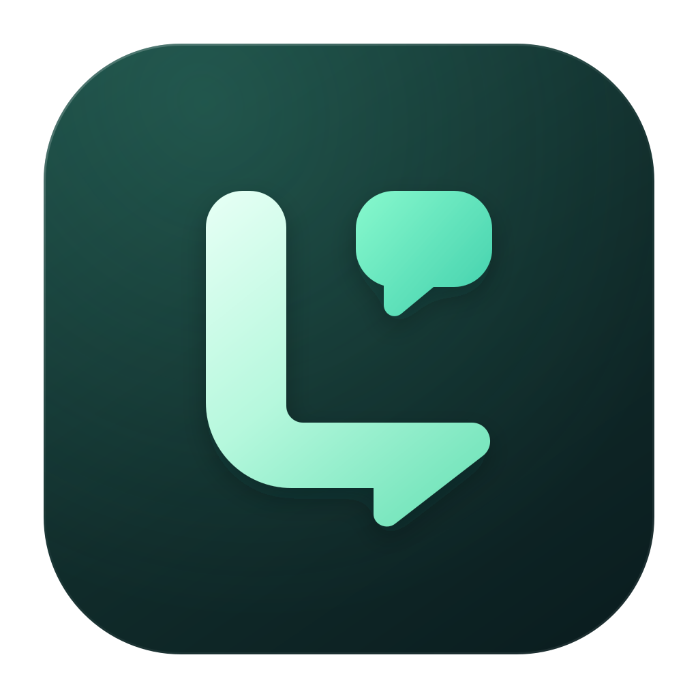
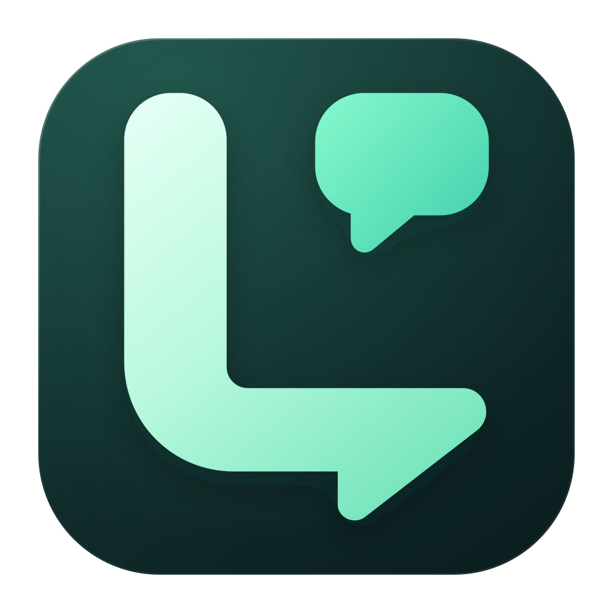

#+TITLE: Loki的助理 图标设计

* 方案：对话中的 L

以字母 L 为主体，横向笔画末端延伸成对话尾角；右上方的独立气泡表示助理的回应。圆润轮廓与大块留白用于保持小尺寸下的辨识度。

应用版本使用深绿色圆角底板、薄荷白主体与薄荷绿回应气泡；菜单栏版本保留相同轮廓，使用纯黑和透明背景，运行时按 template image 处理，以适配浅色和深色外观。

Chrome 插件使用专用彩色母版，L 与气泡放大 45% 并上移居中，在深色和浅色工具栏上均保留深绿底板与薄荷色主体的对比。

本版设计已确认保留，应用中文显示名称为“Loki的助理”。标准 AppIcon asset catalog 已接入 macOS 应用打包，菜单栏使用单色 template 图标，随系统外观自动调整颜色。

各应用 SVG 母版统一维护在根目录 ~resources/icons/~ ，macOS 与 HarmonyOS 共用应用母版，Chrome 使用专用母版。HarmonyOS 的应用、Ability 与启动窗口均引用 ~AppScope/resources/base/media/app_icon.png~ ，Chrome action 图标导出到 ~chrome-plugin/extension/icons/~ 。

* 设计资产

- 
- 
- 
- [[file:../apps/center/mac/Resources/AppIcon/loki-assistant-v1.icns][macOS ICNS 图标]]
- [[file:../apps/center/mac/Resources/Assets.xcassets/AppIcon.appiconset/Contents.json][应用构建使用的标准 AppIcon asset catalog]]
- [[file:../apps/center/mac/Resources/AppIcon/loki-assistant-v1.iconset/][完整 macOS PNG iconset（10 个尺寸文件）]]
- 
- 
- 
- [[file:../apps/harmony/AppScope/resources/base/media/app_icon.png][HarmonyOS 应用 1024 × 1024 PNG]]
- 
- 

* 制作与检查

原生 SVG 绘制，通过 ~rsvg-convert~ 导出 PNG，使用 ~iconutil~ 生成包含 16、32、128、256、512 pt 及各自 @2x 版本的 ICNS。未使用 AI 生图工具。

导出入口为根目录 ~make export-icons~ ，调用 ~scripts/export-icons.py~ ，需要 Python 3、~rsvg-convert~ 和 macOS 自带的 ~iconutil~ 。脚本从公共 SVG 母版生成 macOS 的 PNG iconset、ICNS、asset catalog、菜单栏图标和 Chrome 插件的 16 至 128 像素 PNG，并将同一张应用图标导出为 HarmonyOS 的 1024 × 1024 PNG。全部格式生成成功后再更新各应用目录中的文件；构建直接使用仓库中导出的资源，无需在每次构建时安装导出工具。

Xcode 将菜单栏 20/40 像素 PNG 合并为多倍率 TIFF。应用通过 ~Bundle.main.image(forResource:)~ 加载，设置 ~isTemplate~ 后交给 ~Image(nsImage:)~ 显示；资源缺失时回退到系统图标。

已检查 SVG 可解析、PNG 尺寸与透明通道、ICNS 输出，并核对应用打包后的显示名称、图标资源与菜单栏 Retina 表示。重建并重启应用后，已通过实际菜单栏截图确认 L 与回应气泡正常显示，启动日志中不再出现图标查找失败。

* 通知来源图标排查

通知左侧来源图标由 macOS 根据发送应用的 Bundle ID 和图标资源读取；右侧 Emacs 图标是通知附件，分别来自不同的资源。不能通过替换 Emacs 附件修复来源图标。

已复现左侧显示系统占位图、右侧 Emacs 附件正常的情况。应用现使用标准 ~AppIcon.appiconset~ ，Xcode 编译生成 ~Assets.car~ 和 ~AppIcon.icns~ ，并设置 ~CFBundleIconName~ 。同时修正 ~Info.plist~ 的版本字段展开，确保构建包含有效的 ~CFBundleShortVersionString~ 和 ~CFBundleVersion~ 。

应用构建与资源核对已通过。解锁后再次发送测试通知，左侧仍显示占位图，右侧 Emacs 附件正常。使用非隐藏目录的应用副本、刷新通知进程、清理本应用的过期签名来源登记和显式设置运行时应用图标，均未改变结果；这些临时排查改动已恢复。直接按 Bundle ID 请求系统图标服务能够读取正确的 Loki 图标，因此不能将问题简单归因于缺少图标文件。

后续已完成固定标识的 ad-hoc 签名及 Apple Development 签名副本对照，普通通知仍显示占位图；测试副本已清理，正式应用继续使用原有签名设置。显式提供内部通知图标字段也没有改变显示，该实验代码未保留。

对本应用的通知登记做完整备份并重新建立后，macOS 的“Loki的助理”通知授权提示已显示正确的 L 图标。当前等待完成系统通知授权，再验证普通通知横幅中的来源图标；尚不能把普通通知问题记为已完成。其他应用的通知设置与通知历史未修改，原有本应用登记已单独备份。
