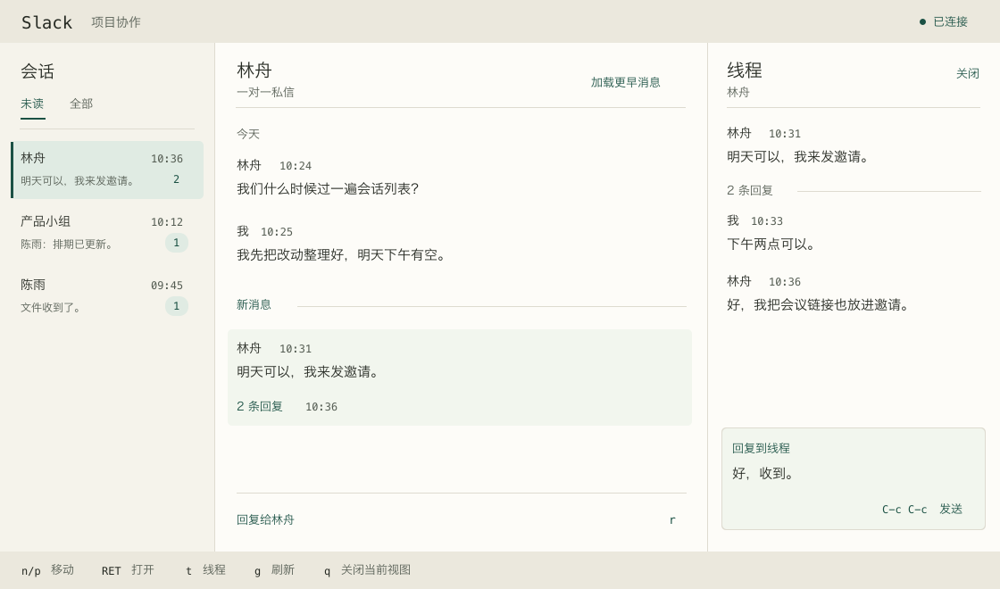

#+TITLE: Slack 后台接入与 Emacs 使用
#+DATE: 2026-11-20

* 结论和首期范围

采用同一个内部 Slack App 的用户 OAuth 和 Socket Mode。用户首次在浏览器批准应用访问，随后 services 以用户级 LaunchAgent 持有授权，后台接收 Slack 事件并发送 macOS 通知。Emacs 通过现有的异步本机 HTTP 客户端读取收件箱、会话和线程，并用授权用户的身份发送回复。Socket Mode 由 services 主动建立出站 WebSocket。 [[https://docs.slack.dev/authentication/using-pkce/][桌面 OAuth PKCE]]、[[https://docs.slack.dev/apis/events-api/using-socket-mode/][Socket Mode]]、[[https://docs.slack.dev/reference/methods/chat.postMessage/][发送消息]]

可配置多个 Slack 项目，每个项目独立授权并同步一对一私信与多人私信。收件箱维护 Loki 本地已读状态。频道与 Slack 原生已读同步属于后续范围。本地 Slack 替身已验证授权、实时私信、通知和回复，目标工作区的应用审批、私信事件投递及发送身份待实测。 [[https://docs.slack.dev/apis/events-api/][Events API 的授权视角]]、[[https://docs.slack.dev/reference/methods/conversations.mark/][Slack 会话已读游标]]

* 首次配置与使用

1. 在目标工作区批准 Loki Assistant 的 Slack App。应用启用 Socket Mode、PKCE 和私信用户事件。OAuth Redirect URL 使用 ~http://localhost:47321/slack/oauth/callback~ ，端口与 services 的实际监听端口一致。构建时通过 ~LOKI_SLACK_CLIENT_ID~ 将 Slack App 的公开 Client ID 编入 services。
2. 在 ~M-x loki-assistant-config~ 中选择「新增工作区」，填写 Slack Team ID 和本地显示名称。Slack 网页 URL 中 ~/client/~ 后的 ~T...~ 是 Team ID。应用令牌可以引用已有 pass 条目，留空时使用 ~loki-assistant/slack/{team_id}/app-token.gpg~ 。
3. 保存时会自动打开浏览器进行授权。Slack 确认返回的 Team ID 后，services 保存工作区并显示 OAuth 凭据引用。浏览器打开失败、用户拒绝或 Team 不匹配时，表单内容可继续编辑。工作区授权完成后，可用「检查已有令牌」或「录入应用令牌」配置 Socket Mode。
4. 在 ~M-x loki-assistant-slack~ 按 ~P~ 切换项目，~u~ 切换未读或全部会话，~RET~ 打开会话，~t~ 打开线程，~r~ 起草，~C-c C-c~ 发送。~m~ 更新本机已读位置，~o~ 读取更早消息，~g~ 刷新。通知点击后打开对应项目。

统一配置分组的通用规则见 [[file:control-center-services.org::*结构化配置][结构化配置]]。

* 工作区配置元数据

Slack 声明 ~slack/teams~ 为 ~SlackTeam~ 数组。以下是 ~modules[].items~ 中的配置项摘录。

#+begin_src json
{
  "key": "teams",
  "data_type": "list",
  "requires_local_auth": true,
  "save_timeout_seconds": 650,
  "list": {"item_type": "structure"},
  "structure": {
    "type_name": "SlackTeam",
    "id_field": "team_id",
    "label_field": "name",
    "fields": [
      {"key": "team_id", "label": "Slack Team ID", "data_type": "string",
       "required": true, "checker": {"pattern": "^T[A-Z0-9]{1,47}$", "description": "请输入以 T 开头的 Slack Team ID。"}},
      {"key": "name", "label": "本地显示名称", "data_type": "string", "required": true},
      {"key": "password_id", "label": "应用令牌条目", "data_type": "password_reference", "required": false,
       "default_template": "loki-assistant/slack/{team_id}/app-token.gpg",
       "options": {"path": "/password/entries", "items_field": "files"}},
      {"key": "oauth_credential_id", "label": "OAuth 凭据引用", "data_type": "string",
       "required": false, "read_only": true}
    ]
  }
}
#+end_src

Slack 在 ~teams.team_id~ 上标记新增处理器，并由 ~Services~ 注入实现。配置服务校验输入后，将新记录交给已注册的处理器。Slack 负责打开浏览器、接收 OAuth 回调、核对 Team ID、保存 Keychain 凭据并提交新记录。

** 接口与界面交互

| 操作 | 请求 | 结果 |
|------+-------+------|
| 读取配置定义和值 | ~GET /meta~、~GET /data/{module}~ | 生成结构表单或数组列表 |
| 保存记录 | ~PUT /data/{module}/{key}/{instance}~ | 普通更新返回 ~200~ ，新增使用 ~If-None-Match: *~ 。已存在的主键返回 ~412 config-record-exists~ |
| 新增带处理器的记录 | 同上，按配置项元数据附带本机 Bearer 凭据 | 处理器完成后返回 ~200~ 和保存结果，失败返回配置错误 |
| 检查已有令牌 | ~POST /config/actions/slack/check_app_token/{instance}~ | Slack 按保存的 ~password_id~ 通过 pass 读取并检查令牌 |
| 录入应用令牌 | ~PUT /data/slack/app_token~ | 根据操作 Metadata 提交 Team ID 和掩码输入，响应返回保存标记 |
| 重新授权 | ~POST /config/actions/slack/authorize/{instance}~ | Slack 打开浏览器并处理回调，完成后返回操作结果 |

1. 在统一配置页保存新工作区时，Emacs 发送普通保存请求。Slack 从 services 打开浏览器。
2. Slack 用 OAuth 回调换取用户令牌，核对返回的 Team ID，将 OAuth 凭据写入 Keychain 后保存配置和只读引用。
3. 浏览器打开失败、用户拒绝、Team 不匹配或授权过期时，保存请求返回错误。Emacs 保留输入供重试。
4. 选择已有密码条目或录入应用令牌后，Socket Mode 连接状态在 Slack 界面查询。

* 应用授权与凭据

- 在目标工作区创建内部 Slack App，启用 Socket Mode 与 Event Subscriptions，在用户事件中添加相应的 ~message.*~ 事件，生成带 ~connections:write~ 的 app-level token。它只用于 ~apps.connections.open~ 获取临时 WebSocket URL。历史查询和回复使用同一应用安装所签发的 user token。工作区开启应用审批时，安装和授予权限由管理员审批。 [[https://docs.slack.dev/reference/app-manifest/][Manifest 字段]]、[[https://docs.slack.dev/reference/scopes/connections.write/][Socket Mode 权限]]、[[https://docs.slack.dev/admins/managing-app-approvals/][应用审批]]
- 启用 Slack OAuth PKCE，将应用注册为 public client。Slack 明确支持 PKCE 应用的 ~http://localhost:<port>/...~ 桌面回调。首期使用固定配置的 ~http://localhost:47321/slack/oauth/callback~ ，安装时核对 services 实际监听地址、端口和 Slack 注册地址。桌面回调只申请 user scopes。启用 PKCE 后恢复为非 public client 需联系 Slack 支持，试验使用独立的内部 App。 [[https://docs.slack.dev/authentication/using-pkce/][启用 PKCE 和桌面回调规则]]、[[https://docs.slack.dev/changelog/2026/03/30/pkce/][PKCE 正式发布说明]]
- 配置页保存新工作区时，Slack 模块从 services 打开系统浏览器并等待授权结果。services 在内存保存有期限、一次性的随机 ~state~ 和 ~code_verifier~ ，使用 ~S256~ 生成 ~code_challenge~ ，校验回调后调用 ~oauth.v2.access~ 换取 ~authed_user~ 下的 token，再用 ~auth.test~ 确认工作区及用户。授权 URL 和兑换请求使用相同的 ~redirect_uri~ 。OAuth code 不写入日志，并在回调完成后跳转到无查询参数的本机结果页。 [[https://docs.slack.dev/authentication/installing-with-oauth/][OAuth 授权与兑换]]、[[https://docs.slack.dev/reference/methods/auth.test/][确认 token 身份]]
- 应用令牌通过配置系统的 ~password~ 类型写入 pass，项目配置保存 ~password_id~ 。已有默认项目仍能加载此前保存在 Keychain 中的应用令牌，也可重新录入到 pass。Slack OAuth access token、refresh token 与过期时间由 Keychain 按项目保存。 [[file:../services/README.org][后台运行方式]]
- 为此安装验证是否签发轮换 token，并启用 Slack 的 Token Rotation 配置。若签发轮换 token，按响应的 ~expires_in~ 提前刷新，同一账户只允许一个刷新任务，新 access token 和 refresh token 成对保存。Slack 文档列出 12 小时 access token 有效期和 PKCE 应用 30 天 refresh token 有效期。凭据撤销或刷新凭据失效时显示需重新授权，并停止读取该账户的缓存与发送消息。 [[https://docs.slack.dev/authentication/using-pkce/][PKCE 刷新规则]]、[[https://docs.slack.dev/authentication/using-token-rotation/][Token Rotation]]

** 权限与事件

| 会话 | 用户事件 | 用户 scope |
|------+----------+------------|
| 一对一私信 | ~message.im~ | ~im:read~、~im:history~ |
| 多人私信 | ~message.mpim~ | ~mpim:read~、~mpim:history~ |
| 公开频道 | ~message.channels~ | ~channels:read~、~channels:history~ |
| 私有频道 | ~message.groups~ | ~groups:read~、~groups:history~ |

~*:read~ 用于会话目录，~*:history~ 用于用户事件、历史和线程，回复另加用户 scope ~chat:write~ 。若需要把发件人 ID 解析为显示名，再增加 ~users:read~ 。频道阶段通过消息中的 ~<@用户ID>~ 识别直接提及。事件覆盖由工作区授权及用户对会话的可见性决定。Bot 安装适合 bot 可访问的会话，普通用户之间的既有私信需要用户授权。 [[https://docs.slack.dev/reference/methods/users.conversations/][会话目录]]、[[https://docs.slack.dev/reference/events/message.im/][私信事件]]、[[https://docs.slack.dev/reference/events/message.mpim/][多人私信事件]]、[[https://docs.slack.dev/reference/events/message.channels/][公开频道事件]]、[[https://docs.slack.dev/reference/events/message.groups/][私有频道事件]]、[[https://docs.slack.dev/reference/scopes/chat.write/][发送权限]]

* services 接入

~services/src/modules/slack/~ 维护 Slack 类型、授权、连接、消息存储和 HTTP 协议。~Services~ 注入现有 ~NotificationService~ ，由 ~main.rs~ 启停 Slack 后台任务。Slack 未配置、断线或授权失效时，本机 HTTP 服务继续响应，Emacs 可以查看模块状态。实现使用 ~reqwest~、~tokio-tungstenite~ 和用户私有的原子 JSON 缓存。 [[file:control-center-services.org][模块和路由约定]]

- 接收链路使用 ~apps.connections.open~ 获取连接地址，处理 ~hello~、ping/pong、~disconnect~ 与 ~refresh_requested~ 。连接失败后指数退避并加抖动，新连接拿到 ~hello~ 后可切换并关闭旧连接。对收到的 ~events_api~ 消息先校验应用和工作区，快速提交到本地数据库，再用 ~envelope_id~ 确认。通知由独立任务处理，发送失败不会延迟确认。已确认或重复投递的 envelope 仍按协议确认。 [[https://docs.slack.dev/apis/events-api/using-socket-mode/][连接刷新与确认]]
- 用 ~event_id~ 去重事件，用工作区、会话 ID、消息 ~ts~ 标识消息。~ts~ 和 ~thread_ts~ 原样保存为字符串，保持 Slack 的小数精度。在仅当前用户可访问的目录保存必要的消息、线程索引、读取位置与待发通知，并设置保留期限。消息编辑和删除更新缓存，不生成新消息通知。仅通知符合规则的新消息，排除授权用户自己的消息。通知默认显示通用标题，正文预览由用户打开，通知点击调用 ~POST /slack/teams/{team_id}/open~ 。Slack 模块通过 Emacs gateway 打开对应工作区。 [[https://docs.slack.dev/apis/events-api/][事件结构]]、[[file:control-center-services.org::*系统通知模块][项目通知约定]]
- Slack Events API 尽力投递。断线或休眠恢复时，对已同步会话按上次同步位置用 ~conversations.history~ 补拉，并用 ~conversations.replies~ 刷新已知活跃线程。首次读会话和展开线程时按需分页，补拉默认不逐条弹通知。旧线程里漏掉的回复可在展开该线程时重新查询，界面显示同步状态。按工作区及方法处理 ~429~ 的 ~Retry-After~ 。内部自建应用保留 Tier 3，商业分发且未上架的应用新安装适用每分钟 1 次、单页最多 15 条的限制。 [[https://docs.slack.dev/reference/methods/conversations.history/][历史分页]]、[[https://docs.slack.dev/reference/methods/conversations.replies/][线程分页]]、[[https://docs.slack.dev/apis/web-api/rate-limits/][限流处理]]、[[https://docs.slack.dev/changelog/2025/05/29/rate-limit-changes-for-non-marketplace-apps/][历史接口限流政策]]
- 发送时用已授权的 user token 调用 ~chat.postMessage~ 。会话 ID 和线程根消息的 ~thread_ts~ 取自请求路径。Emacs 每次主动提交时通过 ~Idempotency-Key~ 标识请求，services 持久登记并合并重试。发送成功的记录包含 Slack 的 ~ts~ ，缓存消息与随后收到的事件按该标识合并。Slack 接收结果不明时保留草稿，标记发送结果待核对，刷新目标会话供用户确认。 [[https://docs.slack.dev/reference/methods/chat.postMessage/][发件身份与线程参数]]

** 本机 HTTP

Slack 模块提供仅本机访问的 JSON API，供 Emacs 发现授权状态、分页读取会话和线程、更新本机已读位置及查询异步发送结果。端点、请求和响应字段及错误语义见 [[file:slack-api.org][Slack 本机 HTTP API v1]]。

Emacs 复用 ~loki-assistant-request~ 。首期在可见的 Slack buffer 中定时刷新最近一页与未读摘要，~g~ 也可手动刷新。Emacs 按请求目标和发起次序忽略迟到结果，保留光标、阅读位置和草稿。断网时沿用已有视图并显示缓存状态。打开列表和翻旧页保持已读位置，用户阅读后再推进当前视图的已读位置。 [[file:emacs.org::*通用 HTTP 请求][Emacs HTTP 客户端]]

* Emacs 界面方案

** Gnus

可以写自定义 Lisp 后端并作为 secondary select method 加载。把一条 Slack 会话映射为 Gnus group，一条消息映射为 article。后端提供 group 列表、文章头和正文查询。文章编号在同一 group 内稳定，~Message-ID~ 根据工作区、会话和 Slack ~ts~ 生成，线程回复的 ~References~ 指向根消息。可以继续用 Gnus 查看未读、跳过已读、展开线程和批量标记。后端接口按同步调用设计，宜先用现有异步 HTTP 客户端更新快照，再由 Gnus 从快照读取，避免每篇 article 都发一个 HTTP 请求。 [[https://www.gnu.org/software/emacs/manual/html_node/gnus/Select-Methods.html][Gnus Select Methods]]、[[https://www.gnu.org/software/emacs/manual/html_node/gnus/Threading.html][Gnus Threading]]

Gnus 的 ~r~ 是邮件回复，~f~ 按组类型选择新闻跟帖或邮件。若增加 Slack 发送，要为 Slack group 提供专用回复绑定和草稿发送函数，从文章的会话 ID 和根 ~thread_ts~ 生成 API 请求，保留该组的回复目的地并隔离其他 group 的发送设置。Gnus 的已读集合可对单篇文章打标记，Slack 视图按会话和线程使用已读游标，因此接入初期可把 Gnus 自己的标记作为其本地阅读记录。 [[https://www.gnu.org/software/emacs/manual/html_node/gnus/Reply-Followup-and-Post.html][Gnus 回复与跟帖]]

** 独立会话界面

~loki-assistant-slack.el~ 提供交互命令 ~loki-assistant-slack~ 。宽窗口用标准 Emacs 窗口展示会话、时间线和线程，窄窗口依次进入会话、线程和草稿。界面的颜色和字体跟随 Emacs 主题。

- 左侧用 ~tabulated-list-mode~ 展示“未读”和“全部”会话，行内显示名称、最新摘要、时间与未读数。~n~ / ~p~ 移动，~RET~ 打开。
- 主窗口用只读 buffer 展示按时间排列的聊天、首条未读位置和每条根消息的回复数。~r~ 起草会话消息，~t~ 或回复数链接打开当前消息的线程。
- 线程视图显示根消息和回复。在线程内按 ~r~ 创建独立草稿，草稿上方明确显示发送到该线程。~C-c C-c~ 发送，~C-c C-k~ 取消草稿。更新或切换窗口时按会话和线程保留各自的草稿。
- ~g~ 刷新当前视图。~q~ 关闭当前视图并回到上一级。阅读旧消息时保留光标和滚动位置，新消息到达后通过未读条数或分隔线提示。

 · [[file:../design/emacs/slack.fig][OpenPencil 源文件]]

** 取舍

| 维度 | Gnus 后端 | 独立会话界面 |
|------+-----------+--------------|
| 未读处理 | 适合与邮件和新闻一起批量处理，沿用 Summary 操作 | 支持 Slack 专用未读收件箱，邮件和 Slack 各有入口 |
| 连续对话 | 按文章打开正文，适合低频阅读和按线程浏览 | 同屏浏览上下文，适合来回回复和多会话切换 |
| 回复目标 | 需要 Slack 专用命令和发送函数 | 视图与草稿直接绑定会话或线程 |
| 实现成本 | 可复用 Gnus 的列表、线程和标记，需维护编号、文章头及消息状态映射 | 需要维护列表、窗口和键位，直接使用 Slack 数据与已读语义 |

首期选择独立会话界面，保留 Gnus 用户熟悉的未读优先和单键导航。若日常主要在 Gnus 里处理邮件和积压消息，再用同一套本机 HTTP 增加只读 group，验证批量浏览的使用频率后决定是否接入 Slack 专用回复。

* 实施与验收顺序

1. 在目标工作区获准的测试会话中验证用户权限。使用同一 Slack App 完成 PKCE 授权和 Socket Mode 连线，确认 ~message.im~ 与 ~message.mpim~ 来自用户的既有会话，再从用户自己的身份发送一条线程回复。普通私信投递、用户身份和获批 scope 是决定首期能否覆盖原需求的验证点。
2. 接入 services 后验证后台运行。关闭 Emacs，发送一条测试消息并检查 macOS 通知。再打开 Emacs 确认同一消息可读。覆盖重复事件、通知失败、服务重启、断网补拉、刷新失败和工作区撤销。
3. 接入 Emacs 会话与草稿，验证一对一及多人私信的阅读、线程回复、失败保留草稿、请求结果未知时的核对，以及点击通知打开收件箱。后台与 HTTP 行为先用模拟 Slack 服务验证，Emacs 通过仓库已有的 ~make emacs-test~ 验证。频道权限随后按需增加。
